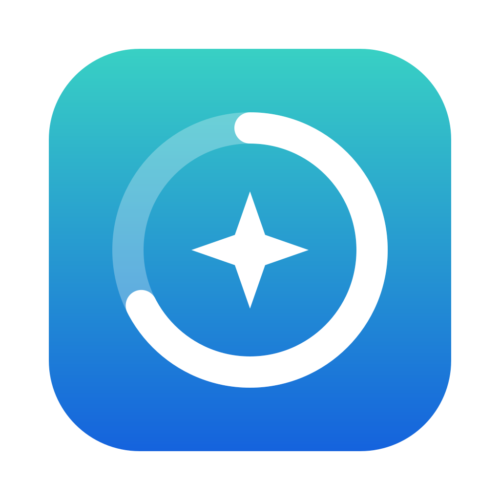
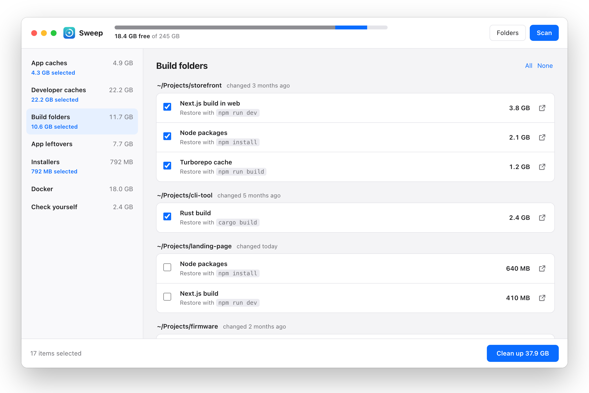

<p align="center">
  
</p>

<h1 align="center">Sweep</h1>

<p align="center">
  Free up space on your Mac or Windows PC. Sweep finds caches, old build folders and leftovers from deleted apps, and deletes only what you pick.
</p>

<p align="center">
  <a href="https://github.com/arifurrahmanns/sweep/releases/latest"></a>
  <a href="https://github.com/arifurrahmanns/sweep/actions/workflows/ci.yml"></a>
  
  
  <a href="LICENSE"></a>
</p>

<picture>
  <source media="(prefers-color-scheme: dark)" srcset="docs/screenshot-dark.png">
  
</picture>

## Download

Get the latest version from [Releases](https://github.com/arifurrahmanns/sweep/releases/latest).

**macOS:** open the `.dmg` and drag Sweep to Applications. It runs on Apple silicon and Intel Macs.

> [!NOTE]
> Sweep isn't signed with an Apple Developer ID. The first time you open it, go to **System Settings → Privacy & Security** and click **Open Anyway**.

Give Sweep **Full Disk Access** (System Settings → Privacy & Security → Full Disk Access) so it can scan Documents, Downloads and other apps' data without macOS asking about each folder. Without it, Sweep skips those places.

**Windows:** run the `-setup.exe`. It installs for your account only, so it doesn't need an administrator. If Windows says it protected your PC, click **More info**, then **Run anyway**.

## What it finds

| | |
|---|---|
| **App caches** | Chrome, Edge, Spotify, Slack and the rest of `~/Library/Caches`; on Windows also old temporary files |
| **Developer caches** | npm, Yarn, pnpm, Bun, Cargo, Gradle, Maven, NuGet, Xcode and Puppeteer |
| **Build folders** | `node_modules`, `.next`, `.turbo`, `target`, `.pio`, `Pods` and .NET `bin`/`obj` in your projects |
| **App leftovers** | Files from apps you've deleted, like Cursor, Arduino IDE or Discord |
| **Installers** | `.dmg`, `.pkg`, `.exe` and `.msi` files for apps you've already installed |
| **Docker** | Unused images and build cache |

## Safe by default

- Nothing is deleted until you review the list and confirm.
- Only safe items are selected for you: caches, installers for apps you already have, and build folders in projects you haven't touched for 30 days.
- Leftovers, Docker data and anything else that can't come back need an extra click.
- Sweep never deletes anything in `~/.ssh`, Keychains, iCloud Drive, Mail, Messages or Photos, Windows' saved credentials or Store apps' data, or top-level folders like Documents, Downloads and AppData.
- If something can't be deleted, Sweep tells you why and how to fix it.

## Build from source

You need [Rust](https://rustup.rs) and [Node.js](https://nodejs.org) 20 or later, plus the Xcode Command Line Tools on macOS 12 or later, or the [Visual Studio C++ Build Tools](https://visualstudio.microsoft.com/visual-cpp-build-tools/) on Windows 10 or later.

```bash
git clone https://github.com/arifurrahmanns/sweep.git
cd sweep
npm install
npm run dev
```

`npm run build` creates `Sweep.app` in `src-tauri/target/release/bundle/macos/` on macOS, or an installer in `src-tauri/target/release/bundle/nsis/` on Windows. To run the tests, use `cd src-tauri && cargo test`.

## Release a new version

```bash
npm version patch   # or minor, major
git push --follow-tags
```

GitHub Actions builds the Mac app (Apple silicon and Intel) and the Windows installer, then publishes both on the [Releases](https://github.com/arifurrahmanns/sweep/releases) page.

Signing the Mac app is optional. Without it, releases still build, but macOS may forget Full Disk Access after each update. To sign, run `scripts/create-signing-cert.sh` once and add the two secrets it prints under **Settings → Secrets and variables → Actions**. To build without publishing, open the Release workflow on the Actions tab and click **Run workflow**.

## How it works

Sweep is a [Tauri](https://tauri.app) app. The scanner and cleaner are written in Rust ([`src-tauri/src`](src-tauri/src)), with the Windows folder layout in [`scanner/windows.rs`](src-tauri/src/scanner/windows.rs), and the window is plain HTML, CSS and JavaScript ([`ui`](ui)). The window can only ask Rust to delete items from the latest scan, by ID, and Rust checks every path again before deleting it.

## License

[MIT](LICENSE)
